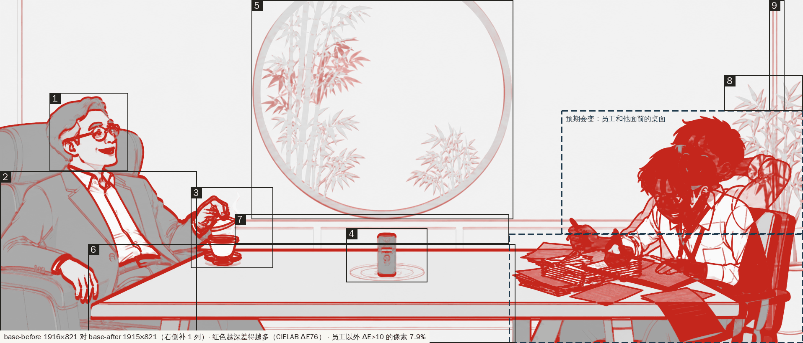

# 招牌插画 v2（hero-v2）

首页招牌换成这里的新图。桌面端播一段约 8 秒的动效：把脉前 → 收住 → 把脉后，播一次停在“把脉后”，点录音笔重播。系统设置了减少动态效果，或屏幕窄于 768px，直接显示 hero-static，不播动画。

- **领导说话时会动嘴**，一秒四五个字，4 秒后停下。
- **六样道具走同一条路**：从嘴边飘到员工的笔记本旁边堆起来，收住时整堆按顺序被吸进录音笔。
- **录音笔正面印着 logo**：一枚声纹指印印章，下面是“把脉了”。

先看效果：`screenshots/hero-v2.mp4`（录像）、`screenshots/sequence-sheet.png`（12 帧联系表）；`mouth-close@2x.png`、`recorder-close@2x.png` 分别是嘴形和录音笔的特写。

## 需要你处理的四件事

1. **base-after 不是在 base-before 上只改员工得到的。** 员工以外还有 7.9% 的像素看得出差别：领导的脸、手、茶杯、录音笔、月洞门里的竹子都重画过，整张图越往下越往上偏（2–8 px）。交叉淡入那 0.8 秒里，领导和桌沿会往上跳几像素，竹子和领导的脸会变样。我照你说的做完了，原图没改。细节见下文“差异图检查”。建议在 base-before 上只重绘员工和他面前的桌面（局部重绘）再出一张 base-after；换上以后跑 `build.py` 和 `check_diff.py` 就行。
2. **原图只有 1916 宽，只生成了 1x。** 不到 3000 像素。桌面和平板的高清屏（比如 Mac 的 Retina）上，图会被放大 1.1–2 倍，略糊；手机宽度小，1x 已经够用。拿到 ≥ 3000 宽（最好 3832 × 1642）的三张原图后，替换 PNG 再跑 `python3 tools/build.py`，会自动生成 `@2x.webp`，并写进 index.html 和 HeroSignboard.vue 的 srcset。
3. **两样素材仓库里没有，我先画了替身。**
   - 道具：`anatomy/` 里只有大饼（dabing）和宏图（hongtu）两张解剖图，没有导出的 icon.svg，也没有脸谱、鸡汤、棋盘、火箭。六样道具是我照 hero-static 里的样子重画的（`props/*.svg`），只用设计系统变量。拿到 anatomy 导出的 icon.svg 后，覆盖 `props/` 里同名的文件，再跑 `build.py`。viewBox 随意，build 会统一大小。它也会检查颜色：不能写死颜色，道具不能用朱砂。
   - 印章：`logo/` 和 `logo-b/` 都是“三指搭脉”方印，没有“声纹指印”的 logo v2。`seal.svg` 是按名字画的替身：朱砂方印，白文指纹，纹线按声波起伏，右边起伏大、左边小。拿到 logo v2 后替换 `seal.svg`，单色，用 `class="f-cinnabar"`。录音笔上的 logo 也取自 `seal.svg`，换了会一起变。
4. **版式变了：** 新图中间上方是道具飞过的路线，牌匾和标语不再压在画上，改放在插画上方（所有宽度都这样）。

## 文件

| 文件 | 说明 |
|---|---|
| `index.html` | 原型页。样式、动效、道具、印章都内联，`?debug=1` 用来调锚点。由 `tools/build.py` 生成 |
| `HeroSignboard.vue` | Vue 3 组件，和 `anchors.json`、`img/` 放在同一个目录里用。由 `build.py` 生成，不要手改 |
| `anchors.json` | 四个锚点，单位是图片宽、高的百分比 |
| `img/*.webp` | 三张图的 1x WebP（1916 × 821，质量 88）：hero-static 153 KB、base-before 118 KB、base-after 105 KB |
| `props/*.svg`、`props/_style.css` | 六样道具（替身）和配色 class，class 都对应设计系统变量 |
| `seal.svg` | 声纹指印印章（替身），一条 evenodd 路径，只用朱砂。录音笔上的 logo 用它的反白版 |
| `wordmark.svg` | 录音笔上的“把脉了”：霞鹜文楷 Bold 的字形轮廓转成的路径，不依赖字体加载。由 `tools/make_wordmark.py` 生成 |
| `checks/diff.png`、`diff-pairs.png`、`diff-report.json` | 差异图、各处的前后对照、数字 |
| `screenshots/` | 录像、联系表，桌面、手机、减少动态效果、调试模式截图，印章、嘴形、录音笔特写，`check.json`（自查结果） |
| `src/` | 源文件：`hero.css`、`motion.js`（动效）、`debug.js`、页面和组件模板 |
| `tools/` | `build.py`、`check_diff.py`、`make_seal.py`、`make_wordmark.py`、`shoot.cjs`（截图自查）、`record.cjs`（录像）、`sheet.py` |
| `hero-v2.zip` | 交付包：上面除 `src/`、`tools/` 和三张原图以外的全部 |
| `hero-static.png`、`base-before.png`、`base-after.png` | 原图，没动 |

## 动效

| 阶段 | 时间 | 画面 |
|---|---|---|
| 把脉前 | 0–4 秒 | 底图 base-before。**领导说话**：嘴一张一合，一秒四五个字，有的字张得大、有的小，4 秒后停下，回到底图张嘴笑的样子。**声浪** 1.8 秒从嘴边走到笔记本：前 15% 只有三道细线，起伏很缓（波长 190）；往后从已有的线上陆续分出另外 9 道，越往员工那边散得越开（到 ±60）、起伏越大越密（波长缩到 75），最后 10% 收进笔记本。**道具**从 0.25 秒起每 0.5 秒放出一样，每样飞 1.42 秒，从 0.32 倍长到 1.25 倍（1 倍边长 150 px），最后一段落到笔记本旁边那一堆上，缩到 0.5 倍，轻轻一弹，停住。落在桌上的不算在空中，空中同时最多三样（1–3.6 秒之间是两三样）。顺序：脸谱书、宏图、大饼、鸡汤、棋盘、火箭，1.7–4.2 秒依次落定。前五样边飘边翻滚（转一圈左右，带轻微压扁）；火箭机头始终朝上（摆动不超过 4°），飞的时候尾焰会闪，落下就熄 |
| 收住 | 4–6 秒 | 声浪掉头：笔记本那头先被拽回来，嘴边那头最后，每一点都沿弧线加速吸进录音笔的机头，起伏一路收平。笔记本旁边那一堆从 4.2 秒起按落下的先后，每 0.12 秒飞走一样，沿弧线进录音笔，边转边缩小，5.0–5.6 秒全部消失在机头。5.15 秒起，录音笔脚下的三圈波纹从里到外各亮一下 |
| 把脉后 | 6–8 秒 | 6.0–6.8 秒交叉淡入 base-after。6.85 秒朱砂印章从 1.75 倍大落到那摞材料上，压一下（0.5 秒），按纸面的透视压扁、斜切，用正片叠底，纸上的字行会透出来。8 秒停住 |

- **重播**：录音笔上盖着一个透明按钮，键盘也能聚焦。鼠标移上去，波纹会淡淡亮起。点了以后先用 0.45 秒淡回 base-before，再从头播。
- 招牌第一次进入视口才开始计时；滚出视口暂停，回来接着播。base-after 还没下载完时，会停在 6 秒等它。
- **减少动态效果，或屏幕窄于 768px**：`<picture>` 按媒体查询直接换成 hero-static；动效层、上层图和按钮都不显示，也不下载 base-after（手机只下载 hero-static 一张）。运行中改窗口宽度或系统设置会跟着切换，切回桌面时直接停在“把脉后”。
- **录音笔上的 logo**：机身正面按键那块盖一块深色铭牌（ink 色，ink-2 细边），上面是素笺色的声纹指印（seal.svg 的反白版）和横排“把脉了”。它在底图上面、动效下面，静态图上也有，位置跟 recorder 锚点走。为了让朱砂只留给最后那枚印章，这里用的是单色；想用朱砂色，把 build.py `decal_markup` 里 `f-sheet` 换成 `f-cinnabar` 就行。
- **领导的嘴**：`build.py` 从页面上显示的同一份 base-before.webp 生成闭嘴、半张、大半张三帧小图（47 × 25 px）：找出嘴（上唇线、牙、口腔、舌头、下唇线连成的一片），逐列把口腔压扁、下唇线往上提，空出来的地方用嘴下方的皮肤色补上，下巴不动。拼回去看不出接缝。嘴要在 mouth 锚点左边 46 px 以内；找不到就不做嘴形动画，build 会提示。
- **颜色**：声浪、道具、波纹、铭牌只用设计系统变量（ink、ink-2、ink-3、line、sheet、indigo、indigo-2、gold、brass、wood），页面没定义变量时用设计稿的值兜底。朱砂只出现在印章上。嘴形是底图本身的像素，不涉及取色。

## 锚点怎么调

`anchors.json` 里的 x、y 是占图片宽、高的百分比，原点在左上角：

| 键 | 现在的值 | 量自 | 用在哪里 |
|---|---|---|---|
| `mouth` 领导嘴边 | 14.61, 43.36 | 两张都一样 | 声浪和道具的起点。放在嘴角右边：build.py 在它左边 46 px 以内找嘴，生成嘴形 |
| `recorder` 录音笔 | 48.17, 74.54 | 两张都一样（机身中心） | 声浪和道具吸进机头（锚点往上 4.0% 图高），波纹画在机身底部（往下 4.7%），铭牌盖在锚点往下 −1 到 34 px，重播按钮以它为中心，宽 4.8%、高 15.2% |
| `notebook` 员工的笔记本 | 77.14, 78.93 | base-before | 把脉前声浪收住的地方；六样道具堆在它左上方（每样的位置写在 `src/motion.js` 的 `slot`，相对这个锚点） |
| `stack` 员工面前那摞材料 | 73.33, 76.25 | base-after | 印章中心 |

1. 在 `hero-v2/` 下运行下面的命令，然后打开 `http://localhost:8000/index.html?debug=1`。这样页面直接读 anchors.json；双击用 file:// 打开读不到，用的是页面里的内嵌副本，面板上会注明。

   ```bash
   python3 -m http.server 8000
   ```

2. 图上的四个圆点就是锚点。可以拖动，可以点选后按方向键（每次 0.05%，按住 Shift 是 0.5%），也可以在下方面板里改数字。画面实时跟着变。点住一个锚点，时间轴会跳到它起作用的那一刻：嘴边跳到 1.3 秒（正在说话），笔记本跳到 4.18 秒（道具刚堆满），录音笔跳到 5.3 秒，材料跳到 8 秒（印章已经盖好）。
3. 面板里的时间轴可以拖，也能用 0.25 倍或 0.5 倍速播放。“参考图”能把 hero-static、base-before 或 base-after 叠上来对位，用滑杆调不透明度。图上的虚线是声浪中线，椭圆是波纹，小虚线圈是道具落下的位置，虚框是重播热区、铭牌和印章的位置。
4. 调好后点“复制 JSON”，整段贴回 anchors.json，再运行 `python3 tools/build.py` 同步 index.html 里的内嵌副本。Vue 组件直接 import anchors.json，不用重新生成。

声浪拱多高、道具多大、出场节奏、堆在哪里、什么时候被吸走，以及印章的透视，都是 `src/motion.js` 开头的常量（`ARCH`、`PROP_PX`、`PROPS` 里的 `slot`、`LAUNCH0 / LAUNCH_GAP / FLIGHT`、`CATCH0 / CATCH_GAP / CATCH_DUR` 等），改完也要跑一遍 `build.py`。

## 差异图检查（base-before 对 base-after）

方法：按 CIELAB ΔE76 逐像素比较，3×3 平滑，ΔE > 10 算看得出的差别。base-after 先在右边补一列再比。重新检查运行 `python3 tools/check_diff.py`。



- **尺寸不一致**：hero-static 1916 × 821，base-before 1916 × 821，base-after **1915 × 821**，窄 1 列。生成 webp 时在 base-after 右边补了 1 列（复制最后一列）。横向内容的偏差在 ±1–2 px 以内，所以没有拉伸。
- **员工以外差别不小**：员工那块（预期会变）有 50.0% 的像素不同；其余地方还有 **7.9%（96,951 像素）**，不符合“几乎没有差别”。
- **整面墙变色**：base-after 偏暗、偏黄，RGB 从 239/233/218 变成 235/228/211（ΔE 2.1）。
- **逐处情况**：序号对应 diff.png 和 diff-pairs.png。位移是 after 相对 before，按 1916 宽算，负数表示往上或往左；“变了”是框内 ΔE > 10 的像素占比。

| # | 地方 | 区域（px） | 变了 | 情况 |
|---|---|---|---:|---|
| 1 | 领导的头和脸 | 118,222 – 306,410 | 24.4% | 五官、眼镜、嘴重画了（after 的嘴张得更大，能看见舌头）；整个头上移 2 px、左移 1 px |
| 2 | 领导的身体和椅子 | 0,410 – 470,821 | 17.8% | 西装、扣子、腰带重画了；越往下偏得越多：肩上移 4.9 px，袖口 7.6 px，扶手上的手 8.0 px |
| 3 | 拿杯盖的手、茶杯、热气 | 455,448 – 652,642 | 30.7% | 手指和杯盖重画，热气形状不同；茶杯上移 5 px |
| 4 | 录音笔和桌上的波纹 | 826,546 – 1020,676 | 12.0% | 按键重画了（三点按钮变成圆环按钮），上移 4 px；脚下波纹的圈数和间距都不同 |
| 5 | 月洞门和门里的竹子 | 600,0 – 1225,525 | 4.5% | 门框下沿上移 3 px；门里的两丛竹子整个重画了 |
| 6 | 桌沿和桌腿 | 210,584 – 1230,821 | 17.0% | 桌子远沿上移 3 px，前沿上移 5–6 px，左桌腿左移 1 px |
| 7 | 墙面腰线和护墙板 | 560,512 – 1215,584 | 10.4% | 上移 3–4 px |
| 8 | 员工头顶上方的盆栽竹叶 | 1728,180 – 1916,265 | 6.2% | 叶子重画，偏 1 px |
| 9 | 右墙竖线 | 1835,0 – 1872,265 | 15.8% | 左移 1 px |

- 另外，hero-static 和 base-before 也不是同一张底图改的：没有道具的地方，领导头脸有 13%、桌面中段有 7% 的像素 ΔE > 10。不过 hero-static 只在静态模式下用，不和动画衔接，影响不大。

## 自查

`node tools/shoot.cjs`（Playwright 自带的 Chromium，1440 宽 1x，霞鹜文楷用本地的 lxgw-wenkai-webfont@1.7.0）30 项全部通过，结果在 `screenshots/check.json`：

- 实时播放 9.5 秒后停在 t = 8，base-after 不透明度 1。点录音笔后先淡回 base-before 再从头播。播放中滚出视口，时间停住；滚回来接着播。
- 0–4 秒每 0.05 秒取一次样：空中道具最多 3 样（落在桌上的不算），1–3.6 秒之间最少 2 样。每样飞到最大时是刚出来时的 3.8 倍。火箭最大倾角 4°，其他五样飞的时候转过 351°–359°。
- 道具的路线：六样都在 1.7–4.2 秒落到笔记本旁边（离笔记本锚点 51–173 px），又都在 5.0–5.6 秒消失在录音笔机头（离机头 10–13 px，收住阶段每 0.01 秒取样）。
- 嘴：3 帧嘴形，0–4 秒的取样里换了 58 次，4 秒以后回到底图。
- 声浪在 0.4 秒时 3 道，3 秒时 12 道。到 6 秒，声浪和道具都没了。波纹最亮时不透明度 0.95。base-after 在 6 → 6.8 秒从 0 淡到 1。8 秒时印章不透明度 0.92。
- 颜色：动效层和录音笔铭牌里每个元素计算出的 fill 和 stroke 都在设计系统色板里（铭牌用 ink、ink-2、sheet）；朱砂只在印章上。
- 减少动态效果、390 宽手机、767 宽：都显示 hero-static，不播动画，不下载两张底图；录音笔 logo 照样显示。768 宽播动画。播放中把窗口拉窄再拉回，表现正常。
- `?debug=1` 标出四个锚点；拖动 20 px 后 JSON 跟着变；file:// 打开时用内嵌副本。各种情况下控制台都没有报错。
- HeroSignboard.vue 用 Vite 5.4 + Vue 3.5.13 构建通过（客户端和 SSR 都试了），SSR 能渲染出完整结构（6 样道具、3 帧嘴形、铭牌）。开发版在 Chromium 里挂载：播完停在“把脉后”，能重播，卸载再挂载都正常，没有 Vue 警告。减少动态效果时显示 hero-static，也不下载 base-after。

## 接入

**Vue 3**：把 `HeroSignboard.vue`、`anchors.json` 和 `img/` 拷进同一个组件目录，然后：

```vue
<script setup>
import HeroSignboard from './hero-v2/HeroSignboard.vue'
</script>

<template>
  <HeroSignboard />
</template>
```

- 需要构建工具能 import JSON 和图片（Vite、webpack 5 默认都支持）。
- 颜色读全站的 `--paper --sheet --line --ink --ink-2 --ink-3 --indigo --indigo-2 --gold --brass --wood --cinnabar`，字体读 `--kai`（霞鹜文楷要全站已经加载）。变量没定义时用设计稿的值。
- 样式没加 scoped，选择器都带 `hero-` 或 `fx-` 前缀。根节点是 `<header class="hero-signboard">`；播放中 `.hero-stage` 上会加 class `is-playing`。

**其他项目**：照抄 index.html 里 `hero-signboard:start` 到 `end` 之间的样式和 `<header class="hero-signboard">` 那段结构，引入 `src/motion.js`，然后调用：

```js
createHeroMotion(document.querySelector('.hero-stage'), anchors)
```

## 重建

```bash
python3 tools/build.py
```

生成 webp、index.html 和 HeroSignboard.vue，需要 Pillow。

```bash
python3 tools/check_diff.py
```

重做差异图。

```bash
python3 tools/make_seal.py
```

重画印章替身。

```bash
python3 tools/make_wordmark.py <lxgw-wenkai-webfont 包目录>
```

重新生成录音笔上的“把脉了”（需要 fontTools 和 brotli）。

```bash
FONT_DIR=<lxgw-wenkai-webfont 包目录> node tools/shoot.cjs
```

截图和自查，需要 Playwright。

```bash
FONT_DIR=<lxgw-wenkai-webfont 包目录> node tools/record.cjs
```

录像，另外需要 ffmpeg。
