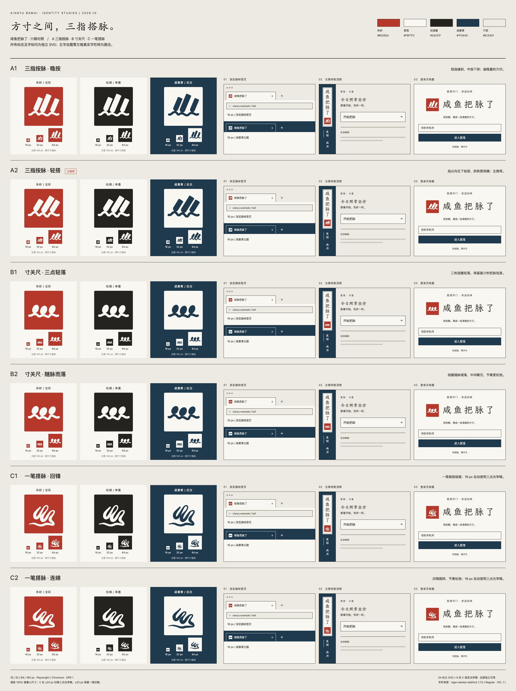

# 咸鱼把脉了 · Logo 候选稿

**推荐 A2「三指按脉 · 轻搭」作为主标志。** 三根短指从右上方斜向搭入，中指最长，圆润指尖与各自的脉线隆起相接。相比 A1，斜势更明确；相比 B、C，直接表达“把脉”的能力更强。B1 是极简方向的首选；C 保留作偏书写气质的备选。

[查看总联系表](screenshots/sheet.png) · [16 像素检查表](screenshots/pixels-16.png) · [打开本地对照页](index.html)



## 六个候选

| 编号 | 设计思路 | 推荐用途 / 判断 |
| --- | --- | --- |
| **A1 · 稳按** | 三段约 23° 的短指，中间最长；指尖以曲线收圆，第一指节端部只留浅弧切口。三个按点各有小幅脉动。 | 较端正、克制；比 A2 更接近抽象斜条。 |
| **A2 · 轻搭** | 约 32° 的斜势，指腹稍宽；中指下探，三处接触点与脉线分别对齐。缩小后仍保留三指和底部脉线。 | **主推荐**。用于方印、横排字标、导航题签与 favicon。 |
| **B1 · 三点轻落** | 三个倾斜椭圆指腹落在浅缓脉线上，中间稍沉，对应寸、关、尺。去掉指节信息。 | 极简首选；16px 下三点最容易数清。 |
| **B2 · 随脉而落** | 指腹倾角更大、位置轻微错落；中间下按，两侧回收，避免单向递增。 | 比 B1 更活泼，适合轻松的品牌语气。 |
| **C1 · 回锋** | 一条连续的三次贝塞尔中心线，三次下按加粗、回锋变细，最后落成宽缓脉线；几何展开为单个闭合笔触轮廓。 | 书写感较强；完整动作辨识度仍弱于 A2。 |
| **C2 · 连绵** | 缩短回锋、让指腹转折更圆；提按节奏略不规则，末笔向左收束。 | 更松弛的书写方向；16px 使用专门光学稿。 |

A、B 的脉线均为圆端三次贝塞尔曲线，接触点轻微隆起，没有折线尖峰。C 的粗细变化由连续中心线和宽度函数展开，未描摹位图，也没有拼接三个孤立符号来伪装“一笔”。

## 直接取用 A2

| 组合 | 全彩 | 单色墨 | 函套青底反白 |
| --- | --- | --- | --- |
| 独立方印 | [mark-color.svg](candidates/A2/mark-color.svg) | [mark-ink.svg](candidates/A2/mark-ink.svg) | [mark-reverse.svg](candidates/A2/mark-reverse.svg) |
| 横排 | [horizontal-color.svg](candidates/A2/horizontal-color.svg) | [horizontal-ink.svg](candidates/A2/horizontal-ink.svg) | [horizontal-reverse.svg](candidates/A2/horizontal-reverse.svg) |
| 竖排题签 | [vertical-color.svg](candidates/A2/vertical-color.svg) | [vertical-ink.svg](candidates/A2/vertical-ink.svg) | [vertical-reverse.svg](candidates/A2/vertical-reverse.svg) |

所有候选遵循同一命名结构：`candidates/{A1,A2,B1,B2,C1,C2}/{mark,horizontal,vertical}-{color,ink,reverse}.svg`。

- 方印：`100 × 100`，近直角方形，只保留 2.5 单位的小圆角。
- 横排：`550 × 120`，印章在左，字标在右；建议显示宽度至少 220px。
- 题签：`64 × 264`，素笺底、1 单位细墨框、纵排五字、底部压印。场景中以 44px 宽放在 78px 侧栏内，底印约 30px。
- 全彩以朱砂为印、素笺为图形、松烟墨为文字；墨版将印章与文字统一为松烟墨；反白版用素笺色印与文字，函套青反刻图形并自带函套青底。
- 题签全彩与墨版保留素笺纸底；反白题签将底、框、字与印整体反转，便于深色导航使用。

## 小尺寸规则

**A、B 使用同一个几何稿直接缩放。C 的独立方印在外部 SVG 视口宽度 ≤24px 时，自动切换为三处厚按点、细脉相连的光学稿；32px 及以上显示完整回锋。** 光学稿也由一条连续、变宽的笔触构成。

这项处理已明确标注在联系表中。它解决的是回锋内白在 16px 下被抗锯齿吞没的问题，不把放大后好看当成小尺寸通过。

C 还提供六个固定光学 SVG：`candidates/C1/mark-micro-{color,ink,reverse}.svg` 与 `candidates/C2/mark-micro-{color,ink,reverse}.svg`。用于不支持 SVG 媒体查询的软件、需要内联 SVG 的场景或手动导出小图。

- 通过 `` 加载时，SVG 的独立视口会触发光学稿。
- 内联 SVG 的媒体查询可能依据宿主页宽度判断；此时应明确选用 `mark-micro-*.svg`。
- C 的横排与题签保留标准笔触；建议其中的方印显示尺寸不小于 28px。
- 最小标志尺寸为 16px。不要把整个横排字标或整条题签压成 16px 图标。

## 设计系统与参考

先阅读并渲染了 `../ref/xianyu-demo-v2.html`、`../ref/xianyu-illustrations.html`。延续参考中的函套青侧栏、素笺题签、克制细框与单处朱砂；将原来文字印章的语义换成“三指搭脉”。没有修改参考稿或其他目录的设计文件。

| 色名 | 色值 | 用途 |
| --- | --- | --- |
| 朱砂 | `#B5382A` | 主方印 |
| 素笺 | `#F8F7F2` | 反刻图形、题签、反白 |
| 松烟墨 | `#24231F` | 字标、细框、墨版 |
| 函套青 | `#1F3A4D` | 深色背景、反白反刻 |
| 竹纸 | `#ECEAE1` | 联系表与场景纸底 |

所有 SVG 都只使用指定色值；无渐变、阴影、发光、位图嵌入、大脑、星光或对话气泡。

## 字形与可移植性

五字来自 **`lxgw-wenkai-webfont@1.7.0` 的霞鹜文楷 Regular，字体版本 v1.250**。使用 fontTools 的 `TTFont`、`SVGPathPen` 和 `BoundsPen` 读取原始 WOFF2 子集，将真实字形转换为 SVG `<path>`，再按原始 1000 units/em 比例排版。

Logo 中没有 `<text>`、运行时字体加载、外部引用或 `<image>`，无需安装霞鹜文楷，也无需联网。独立 SVG 内含各自的完整图形、五字路径和可访问标题。

原始字体子集、字体 OFL 1.1、包的 MIT 许可及可核对的来源和 SHA-256 均保留在 [fonts/](fonts/SOURCE.md)。`fonts/glyphs.json` 是可重建的五字轮廓数据。

## 渲染与自查

Playwright / Chromium，DPR=1，已输出：

- **72 张方印 PNG**：6 候选 × 3 配色 × 16 / 32 / 64 / 180px，见 `screenshots/marks/`。
- **18 张场景 PNG**：每个候选各一张浏览器标签页、左侧导航顶部、登录页标题，见 `screenshots/scenes/`。浏览器场景同时展示浅色及函套青主题，favicon 为实际 16px。
- **总联系表 `screenshots/sheet.png`，2400 × 3208px**；小尺寸检查表 `screenshots/pixels-16.png`，同时呈现原始 16px 和 8 倍最近邻放大。
- 合计 **92 张交付 PNG**、**60 个 SVG**（54 主组合 + 6 固定光学稿）。参考截图与每行工作预览放在被忽略的 `work/` 中。

请用 100% 查看联系表。聊天和网页的整图缩放会再次压缩 16px 样本；像素检查表的放大图仅帮助看连接关系，不能替代原尺寸判断。

### 修订记录

1. 首轮 C 的等粗长回环像回形针，16px 粘成一团，判为不通过；A2 中指与局部波峰存在横向错位。
2. 对齐 A 的指下隆起；收浅 A、B 的波谷，减弱规则 W 和 B2 的“小人”联想。C 改为粗按细提、短回锋，并去掉右侧封闭回环。
3. C 的完整笔触仍无法在 16px 稳定保留内白，增加单笔三点光学稿；再抬高 C2 的中间按点，避免被连接线吞没。

### 最终人工检查

| 检查项 | 结论 |
| --- | --- |
| 三根竖条 / 柱状图 | A 使用斜入、圆指腹、中指最长的关系；B 为椭圆点；C 为提按笔触，没有竖条站在直线上的结构。 |
| 梳子 | 没有共同水平梳背；C 去除长等粗回环，缩小时切为三处厚按点。 |
| Wi-Fi / 信号 | 没有同心弧或单向递增阶梯；三点中间略沉，两侧回收。 |
| 心电图 | 脉线无尖角和尖峰；局部隆起已收浅，连接全部平滑。 |
| 16px | A 可分出三根斜指和底脉；B 可数出三个指腹点；C 光学稿可数出三个厚按点及细连接。A2 的动作语义和 B1 的三点辨识度仍最好。 |

这是依据实际渲染的设计自查与独立复核，并非用户识别率实验；因此推荐仍以 A2 为主，C 作为书写方向备选。

静态审计见 [verification.json](screenshots/verification.json)：60 个 SVG 清单、字形路径、色值、外部依赖、C 连续路径和光学切换规则全部通过。渲染审计见 [render-report.json](screenshots/render-report.json)：缺图 0、场景溢出 0、浏览器错误 0。

## 重建

以下命令从仓库根目录执行，安装文件和临时文件均留在 `logo/` 内。需要 Python 3.9+、Node.js 18+。

```sh
python3 -m venv logo/work/venv
logo/work/venv/bin/pip install -r logo/requirements.txt
logo/work/venv/bin/python logo/scripts/extract_glyphs.py
logo/work/venv/bin/python logo/scripts/build.py
npm ci --prefix logo --cache logo/work/npm-cache
PLAYWRIGHT_BROWSERS_PATH="$PWD/logo/work/browsers" ./logo/node_modules/.bin/playwright install chromium
PLAYWRIGHT_BROWSERS_PATH="$PWD/logo/work/browsers" node logo/scripts/render.cjs
python3 logo/scripts/verify.py
```

字体已随项目保留；提取过程不再依赖 npm 远程包。`build.py` 仅依赖 Python 标准库及保留的字形 JSON。

也可设置 `PLAYWRIGHT_MODULE` 指向已有 Playwright 包，`CHROMIUM_PATH` 指向已有 Chromium/Chrome 可执行文件。`render.cjs` 会重建 `index.html`、尺寸图、场景图、联系表及渲染报告。`inspect_refs.cjs` 可重新查看两份参考稿，网络字体请求会被拦截，参考预览使用系统后备字体；交付 Logo 字标始终使用真实轮廓路径。
