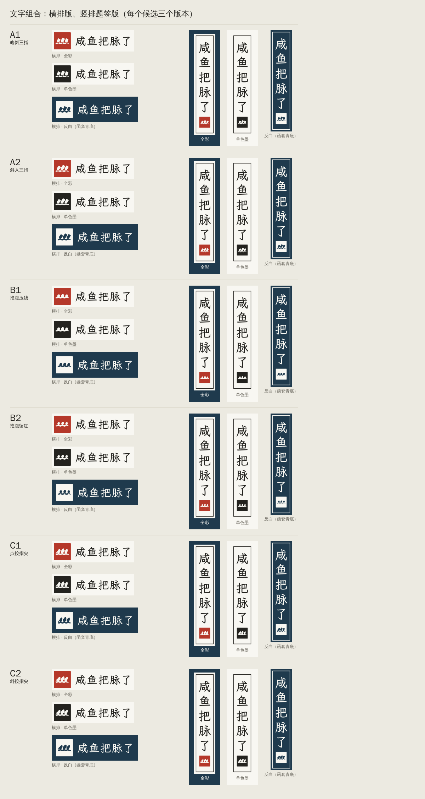
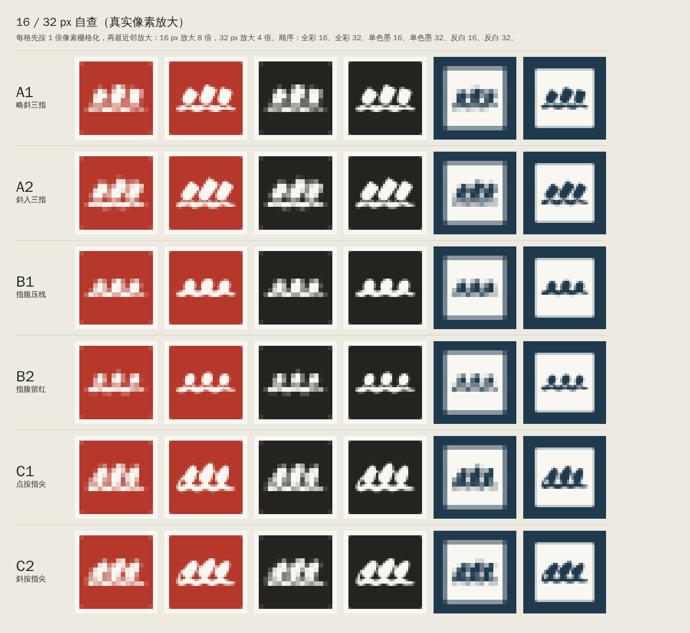
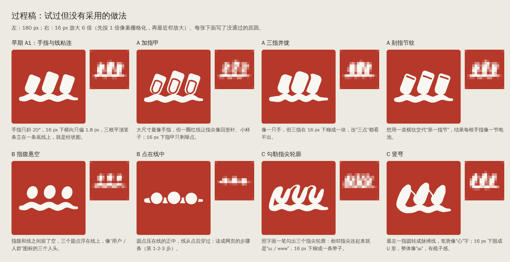

# 咸鱼把脉了 · Logo 候选（logo）

主标志是一枚朱砂方印，印里画“三指搭脉”。三个方向各出两个变体，共 6 个候选。每个候选有三种文件（印章、横排版、竖排题签版），每种都出全彩、单色墨、函套青底反白三个版本。

- 联系表：`screenshots/sheet.png`
- 推荐：**A1 略斜三指**（理由见文末“推荐”）


## 文件

| 路径 | 内容 |
|---|---|
| `svg/<候选>/<候选>-seal-{color,mono,reverse}.svg` | 印章：全彩 / 单色墨 / 反白，6 个候选共 18 个 |
| `svg/<候选>/<候选>-h-{color,mono,reverse}.svg` | 横排版：印章在左，“咸鱼把脉了”在右 |
| `svg/<候选>/<候选>-v-{color,mono,reverse}.svg` | 竖排题签版：素笺底、细墨框，底部压印 |
| `svg/manifest.json` | 文件清单、字体版本、每个候选的留红边距 |
| `png/<候选>/` | 印章三个版本 × 16 / 32 / 64 / 180 px，共 72 张 |
| `screenshots/sheet.png` | 联系表 |
| `screenshots/check-16-32.png` | 16 / 32 px 自查图（真实像素放大） |
| `screenshots/lockups.png` | 文字组合总览：6 个候选 × 横排、题签 × 3 个版本 |
| `screenshots/explorations.png` | 过程稿：试过但没采用的做法，每种写了原因 |
| `screenshots/scenes/` | 单张场景截图：标签页浅色、深色、当前标签特写，左侧导航，登录页 |
| `screenshots/glyph-check.json` | 文字路径和原字体的逐像素核对结果 |
| `screenshots/render-env.json` | 渲染用的 Chromium 版本 |
| `tools/` | 生成、渲染、核对脚本（见“重新生成”） |

SVG 里只有 `<path>`、`<rect>`、`<title>` 三种元素，没有 `<text>`、字体引用、外部链接、渐变、滤镜和透明度，颜色只用朱砂、素笺、松烟墨、函套青四种。这几条都用脚本逐个文件检查过。生成这些截图的环境本身就没有安装霞鹜文楷（系统字体里没有），`screenshots/lockups.png` 里的字就是在这种条件下画出来的。

## 共同规格

| 项目 | 规格 |
|---|---|
| 印面 | 64 × 64 单位，圆角 2（16 px 时约半个像素） |
| 留红 | 图形离印边最少 6.44 单位（16 px 时 1.6 px） |
| 全彩版 | 朱砂印面上铺素笺色图形 |
| 单色墨版 | 印面挖掉图形，只用松烟墨一种颜色，可以直接单色印刷、压印 |
| 反白版 | 同样挖空的印面填素笺色，放在函套青底上，底色四周各留印面边长的 12.5% |
| 脉搏线 | 余弦起伏：波峰正好在三个指尖（指腹）下面，指与指之间回落，两端放平。线宽 5.0–5.2 单位（16 px 时约 1.3 px），起笔略收成圆头，收笔渐细出锋 |
| 留红刻线 | A1、A2、B2 的指尖（指腹）压在线前面，交叠处刻一道 1.3–1.6 单位宽的红线 |

脉搏线没有尖峰，也没有“平直基线加尖刺”的结构，这是它和心电图的区别。

留红刻线是白文印处理笔画相交的常见刻法。大尺寸下它交代了“压在脉上”。16 px 下这道线让手指和脉搏线分开，读成“落在线上的几个点”，不读成“立在轴上的竖条”。

## 六个候选

### A 三指按脉

三节手指（只画指尖到第一指节）从右上方伸进来，中指最长，指尖落在脉搏线的三个波峰上，波峰就是“指下有脉”的隆起。指尖用指数 2.2 的超椭圆，比半圆略钝，像指肚，不像药丸。指节一端截平，两角只倒小圆角，看得出是截出来的一节。

**A1 略斜三指**（推荐）

- 三指倾角 33°、25°、17°，平均约 25°。指根往右上方的手掌收拢，指尖散开。比起三根平行的手指，扇形更像一只真的手，也让三指在 16 px 下互不平行，避开柱状图。
- 指宽约 10.2–11.3 单位；指尖到截口 14.1 / 16.9 / 14.6，长宽比约 1.4–1.6，接近真实的末节手指。
- 16 px：三个倾角不同的小块落在线上，读作“三点落在脉上”。32 px 起能看出是斜伸进来的手指。

**A2 斜入三指**

- 三指平行，倾角 37°、34°、31°，比 A1 长（长宽比约 1.7–2.0），最强调“从右上方伸进来”。
- 16 px 下是三道明显的斜块，六个候选里离柱状图最远。
- 代价：手势更像“伸”，“按”的感觉比 A1 弱。brief 要的是“略微倾斜”，A2 超出了这个范围，放在这里是给你一个对照。

### B 寸关尺

最简版：三个椭圆指腹点依次落在脉搏线的三个波峰上，对应寸、关、尺，中间的“关”大 8%。

**B1 指腹压线**：指腹半轴 4.9 × 6.0，倾斜 22°，压进线里 3.6 单位，和线连成一片。16 px 下是线上三个凸起。

**B2 指腹留红**：指腹半轴 4.4 × 5.6，倾斜 20°，坐在波峰上，交叠处留红。16 px 下三点和线分得最开，是六个候选里 16 px 最清楚的一个。

B 的风险是我自己看图的判断，不在你列的四种误读里：大尺寸下，三个椭圆坐在波浪线上，有人会看成三个人头、三个蛋或三个气球。B 只交代了“三点一线”，看不出手指。

### C 一笔搭脉

一笔写成：

1. 自右向左三次落笔。每一笔从右上起笔（圆头），向左下按满成指尖。
2. 收笔后以 0.9 单位的牵丝挑到下一笔的起点。
3. 三指按完，从最左一指顺势落下，回转成脉搏线。
4. 脉搏线自左向右，在三指下各隆起一次，向右出锋。

笔宽在每个控制点上设定，沿弧长插值，没有用纹理或渐变。

**C1 点按指尖**：手指倾角 22°。

**C2 斜按指尖**：同一笔势，倾角 34°，笔势更急，和 A2 的关系一样。

和 brief 的出入：brief 写的是“先勾出三个指尖”。照字面用线勾出指尖轮廓（U 形），相邻指尖连起来就是“ɯ / www”，16 px 下糊成一条带子。我试过 U 形轮廓、粗细笔 U 形、闭合的环、空心按笔、竖弯这几类写法，都没过 16 px 自查，其中两种放在 `screenshots/explorations.png` 里。现在的 C 用按笔画指尖，“勾”体现在每一笔收笔后挑向下一笔的牵丝上。

## 文字组合

字体是霞鹜文楷 Bold（LXGW WenKai v1.250）。fonttools 从 npm 包 lxgw-wenkai-webfont 1.7.0 的 woff2 子集里找到这五个字，取出轮廓、合并成路径。字重选 Bold：放在实心印章旁边，Regular 显得单薄，40 px 以下也更难认。

**横排版**（`*-h-*.svg`，viewBox 293.8 × 64）

- 印章边长 64；字的 em 框 40，是印章边长的 0.625；字距 3.2（0.08 em）；印与字之间 17。
- 每个字的 em 框（字体的 sTypoAscender 880 到 sTypoDescender −120）上下居中对齐印章。
- 反白版四周留 16（印章边长的 1/4）函套青底。

**竖排题签版**（`*-v-*.svg`，viewBox 70.4 × 334.6）

- 素笺底；细墨框线宽 1.6，离边缘 5.6；字的 em 框 40，竖排字距 8.8（0.22 em）；底部压一方 36 × 36 的印。
- 场景里按参考稿 `ref/xianyu-demo-v2.html` 的左侧导航摆放：在 78 px 宽的函套青竖栏里显示为 38 px 宽，字约 21.6 px，印约 19.4 px。参考稿现有的题签是 CSS 排的字，字号 21 px，框实测 51.7 × 164.5 px；这一版字号相同，框更窄、更长，因为底部多了一方印。
- 单色墨版没有底色，框、字、印都是松烟墨。反白版是函套青底，框、字、印都是素笺色。



## 自查

**方法**：Playwright 自带的 Chromium 153.0.8010.12，deviceScaleFactor 1，16 px 就是 16 个设备像素。小尺寸先栅格化，再用最近邻放大检查。三个场景：

| 场景 | 模拟方式 |
|---|---|
| 浏览器标签页 | 仿 Chrome 的浅色、深色标签栏，图标 16 × 16 CSS px |
| 左侧导航顶部 | 照参考稿的 78 px 函套青竖栏，顶部放竖排题签（全彩版），下面是参考稿里的“医馆 / 病历 / 先生” |
| 登录页标题 | 竹纸底上一张素笺卡片，横排版高 44 px 作标题，下面是账号、密码、登录按钮（这三处是占位文字） |

**逐项结果**：都是我看图的判断，没有找人测试。

| 检查项 | A1 | A2 | B1 | B2 | C1 | C2 |
|---|---|---|---|---|---|---|
| 三根竖条立在线上，像柱状图 | 通过 | 通过 | 通过 | 通过 | 通过 | 通过 |
| 像梳子 | 通过 | 通过 | 通过 | 通过 | 通过 | 通过，但六个里最接近：16 px 下三道斜笔接在线上 |
| 像 Wi-Fi、信号图标 | 通过 | 通过 | 通过 | 通过 | 通过 | 通过 |
| 脉搏线像心电图 | 通过 | 通过 | 通过 | 通过 | 通过 | 通过 |
| 16 px 读出什么 | 三点落在线上 | 三道斜指落在线上 | 线上三个凸起 | 三点落在线上（最清楚） | 三点落在线上 | 三道斜笔落在线上 |
| 32 px 起读出什么 | 手指按在脉上 | 手指按在脉上 | 三点落在脉上 | 三点落在脉上 | 毛笔按出的指尖 | 毛笔按出的指尖 |

Wi-Fi 和信号图标靠同心弧线或从左到右递增的高度来识别。这里没有弧线，三指的高度是中间最高、两边相近，不递增。



**自查后改过的地方**：

1. 早期的 A 手指和线粘连，只斜 18°–22°，长宽比约 1.6–1.8。16 px 下横向只偏约 1.8 px，三根平顶竖条立在底线上，就是柱状图。改法有两处：指尖压线处留红，让手指和线分开；A1 改成扇形，三指不再平行。
2. A1 一度缩到长宽比约 1.3，指尖太方。16 px 过了，180 px 却像三块圆角瓷砖。最后长宽比回到 1.4–1.6，指尖用 2.2 次超椭圆，截口圆角从 3.4 收到 2.0。
3. B1 的指腹只压进线 2.4 单位时，接口处收窄，像人头连着脖子。压到 3.6、指腹半轴从 4.6 × 5.8 放大到 4.9 × 6.0 以后，指腹和线整片相接。
4. C 左侧回环原来是粗笔，16 px 下变成第四根竖笔，和三个按笔一起像一把四齿梳。现在回环的竖向一段是约 1.2 单位的细牵丝，转平以后才加粗成脉搏线。按笔的长宽比也从约 1.7–1.8 缩到约 1.5–1.6。
5. 其他放弃的做法和原因见过程稿：
   - 指甲：像回形针。
   - 三指并拢：16 px 糊成一块。
   - 指节纹：像电池。
   - 指腹悬空：像“人群”图标。
   - 点压在线中：像网页步骤条。
   - 照字面勾指尖轮廓：像 “ɯ”。
   - 竖弯：16 px 像 “ш”。
   
   迭代中还试过弯曲的手指（整体像帆船）和斜放的脉搏线（像挂果的藤），没放进过程稿。



**文字路径核对**：在同一字号（200 px）、同一基线下，一边用浏览器加载霞鹜文楷 Bold webfont 排“咸鱼把脉了”，一边画转出的路径，逐像素比较。20 万个像素里平均差 0.18（满分 255），差值大于 8 的有 658 个，全部在字形边缘的抗锯齿上，字形本身重合。数据在 `screenshots/glyph-check.json`，`npm run verify` 可以复跑。

## 推荐：A1 略斜三指

我按这几条比较，排序是我的判断：

1. **意思最直接**：三节手指、中指最长、从右上方伸进来、按住的地方脉搏线隆起，brief 里 A 方向的每一条都画到了；留红又把“按”的接触交代清楚。B 只剩三点；C 的按笔更像笔触，不太像手指。
2. **小尺寸过关**：16 px 达到最低要求“三点落在脉上”，扇形和留红挡住了柱状图的误读；32 px 起就是手指。
3. **风格一致**：留红是白文印的刻法，和朱砂方印、霞鹜文楷的书卷气是一路。

另外两种情况：

- 如果最在意 16 px 的辨识度，比如主要用在标签页和小图标上，选 B2，它最清楚，但大尺寸下“手指”的意思最弱。
- 如果想和加载动效（`loading/` 里那根从脉搏线变成字的墨线）同一个气质，选 C1，它的毛笔笔意最接近；代价是和“勾出指尖”的字面意思有出入。

## 重新生成

```bash
cd logo
npm install                                  # 霞鹜文楷 webfont：lxgw-wenkai-webfont 1.7.0
pip install fonttools brotli skia-pathops numpy
npm run build    # python3 tools/build.py && node tools/render.cjs && python3 tools/explore.py
npm run verify   # 文字路径和 webfont 的逐像素核对
```

还需要 Python 3 和 Node 版 Playwright（脚本里 `require('playwright')`）。用同样的输入重跑，SVG 和 PNG 逐字节相同（清理代码后重跑核对过）。

| 脚本 | 作用 |
|---|---|
| `tools/glyphs.py` | 遍历 webfont 的 woff2 子集，找到每个字所在的文件，取出字形轮廓 |
| `tools/geom.py` | 基本图形；毛笔线（沿中心线排一串圆求并集，再拟合成三次贝塞尔）；布尔运算（skia-pathops）；SVG 路径输出 |
| `tools/marks.py` | 六个候选的图形和参数 |
| `tools/build.py` | 生成全部 SVG 和 `svg/manifest.json` |
| `tools/render.cjs` | PNG、场景截图、联系表、文字组合总览、16/32 px 自查图 |
| `tools/explore.py` | 过程稿 |
| `tools/verify-glyphs.cjs` | 字形核对 |

## 字体授权

- 霞鹜文楷（LXGW WenKai）v1.250，SIL Open Font License 1.1，许可证全文在 npm 包的 `OFL.txt`。npm 包 lxgw-wenkai-webfont 本身的打包代码是 MIT 协议。
- Logo 里的字是从字体取出的轮廓、转成路径，仓库里没有字体文件（`node_modules` 不进仓库）。OFL 允许用字体制作 Logo 这类作品。如果要把 Logo 注册成商标，建议请法务对照 OFL 全文再确认一次。

## 已知限制

- 16 px 的结论只来自 Chromium 的栅格化。Safari、Firefox 和 Windows 上的小图标渲染没有测过。作为真正的 favicon 时，浏览器在标签栏里怎么缩放 SVG 也没有实测，场景里是用 16 × 16 的 `` 模拟的。
- 场景里的界面文字只是示意。容器里没有系统界面字体和 Noto Serif SC，标签栏用文泉驿正黑代替，导航、表单用霞鹜文楷 webfont。
- “像不像”的判断都是我自己看图得出的。最可靠的检验是找几个没看过 brief 的人，只看 16 px 和 180 px 两档，问他们看到了什么。
